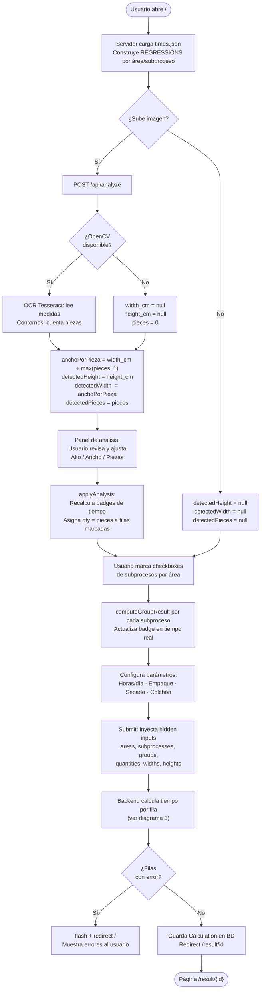
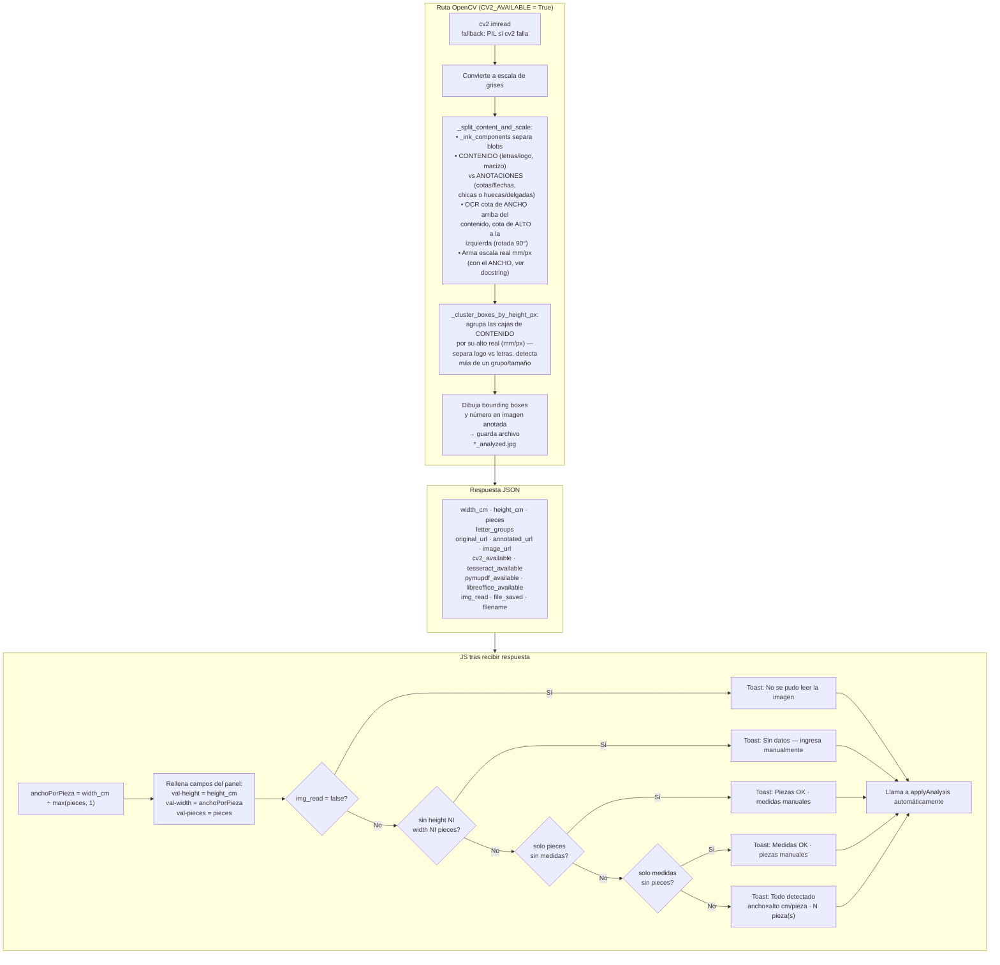
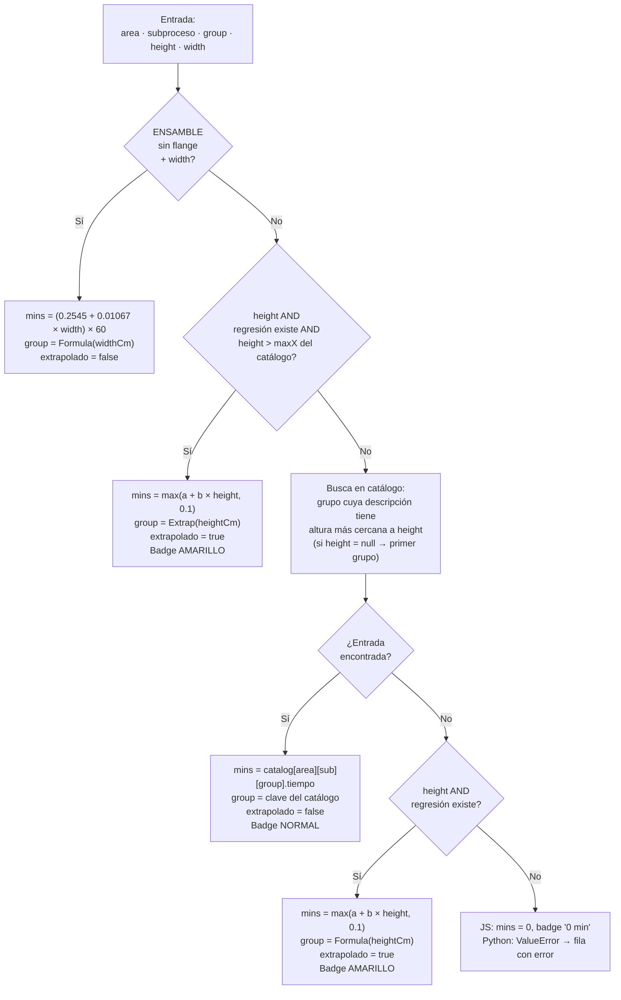
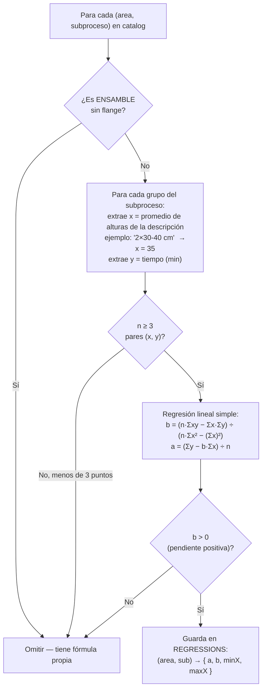
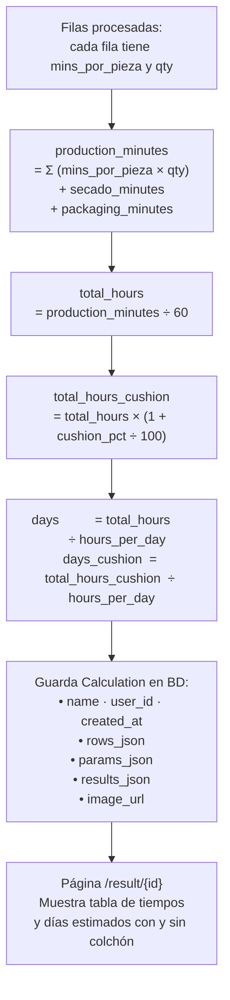
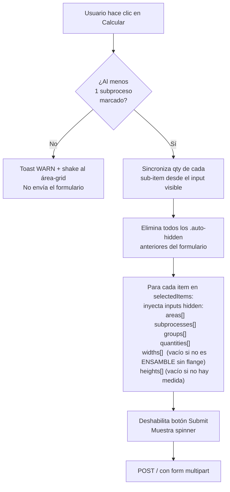

# Diagrama completo — Calculadora SMV Lumicolor

> Abre este archivo en VS Code y presiona `Ctrl+Shift+V` para ver los diagramas renderizados.

---

## 1 · Flujo general de la aplicación



---

## 2 · Análisis de imagen — /api/analyze (detallado)



---

## 3 · Cálculo de tiempo por subproceso  (Frontend JS espeja Backend Python)

> Ambos usan exactamente la misma lógica de prioridad.



---

## 4 · Construcción de regresiones (build_regressions)

> Se ejecuta al iniciar la app y en cada request GET.  
> Solo genera regresión si hay 3+ puntos con pendiente positiva.



---

## 5 · Fórmulas finales y cálculo de resultados



---

## 6 · Tabla de parámetros y valores por defecto

| Parámetro | Default | Dónde se usa |
|---|---|---|
| `hours_per_day` | 9 h | Divide `total_hours` para obtener días |
| `packaging_minutes` | 40 min | Se suma a `production_minutes` |
| `secado_minutes` | 120 min | Se suma a `production_minutes` |
| `cushion_pct` | 10 % | Multiplica `total_hours` por `1 + cushion/100` |
| `anchoPorPieza` | `width_cm ÷ max(pieces, 1)` | Solo para ENSAMBLE sin flange |

---

## 7 · Prioridad de cálculo (resumen ejecutivo)

```
┌─────────────────────────────────────────────────────────────────────────────┐
│  PRIORIDAD  │  CONDICIÓN                               │  RESULTADO         │
├─────────────┼──────────────────────────────────────────┼────────────────────┤
│      1      │  ENSAMBLE sin flange + ancho disponible  │  Fórmula fija      │
│             │  mins = (0.2545 + 0.01067 × ancho) × 60 │                    │
├─────────────┼──────────────────────────────────────────┼────────────────────┤
│      2      │  Alto > máximo del catálogo              │  Regresión lineal  │
│             │  + regresión disponible para ese sub      │  (extrapolación)   │
├─────────────┼──────────────────────────────────────────┼────────────────────┤
│      3      │  Grupo encontrado en catálogo            │  Tiempo del        │
│             │  (altura dentro del rango conocido)      │  catálogo exacto   │
├─────────────┼──────────────────────────────────────────┼────────────────────┤
│      4      │  Grupo NO encontrado en catálogo         │  Regresión lineal  │
│             │  + alto y regresión disponibles          │  (fallback)        │
├─────────────┼──────────────────────────────────────────┼────────────────────┤
│      5      │  Sin catálogo, sin regresión, sin alto   │  Error / 0 min     │
└─────────────┴──────────────────────────────────────────┴────────────────────┘
```

---

## 8 · Fórmula de Ensamble sin flange — detalle

| Concepto | Valor |
|---|---|
| Fórmula | `mins = (0.2545 + 0.01067 × ancho_cm) × 60` |
| Origen | Regresión histórica específica del área ENSAMBLE |
| Parámetro | `widthCm` = ancho **por pieza** (no el total del letrero) |
| Aplica | Solo al subproceso exacto `"Ensamble sin flange"` |
| Excluida de `build_regressions` | Sí — se omite para no generar una regresión redundante |

---

## 9 · Flujo del envío del formulario (Submit JS)


